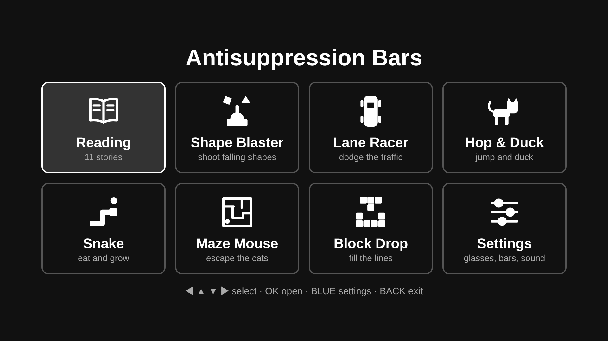

# Antisuppression Bars — web version

Red-green reading bars and games for at-home binocular vision exercises, played in any
web browser with red-green (bichrome) or red-blue glasses. This is the browser edition of the
LG webOS TV app; it shares the same game and bar code.

**🌐 Website: [zouhairzed.github.io/AntisuppressionBars](https://zouhairzed.github.io/AntisuppressionBars/)**
· **🕹️ [Play now](https://zouhairzed.github.io/AntisuppressionBars/play.html)**
· [Privacy policy](https://zouhairzed.github.io/AntisuppressionBars/privacy)

> ⚠️ Supplement only — use under the guidance of an optometrist or ophthalmologist.
> Not a medical device; it does not diagnose or treat any condition.



## What's inside
- **Reading** — 11 original short stories under the bars: 8 in English, 3 in Arabic (right-to-left)
- **Shape Blaster** — move the cannon and shoot falling shapes
- **Lane Racer** — switch lanes to dodge traffic
- **Hop & Duck** — jump blocks, duck birds, collect stars
- **Snake** — eat food, grow longer, avoid the walls and your tail
- **Maze Mouse** — eat every crumb while cats chase you; big cheese scares them
- **Block Drop** — rotate the falling blocks to fill and clear complete lines
- **Settings** — glasses type (red/green or red/blue), vertical (default) or horizontal bars, bar width,
  strength, red / green / blue shades, text size, music and sound effects on/off

Everything runs offline in the browser. Settings and best scores are saved in the browser's
local storage; nothing is sent anywhere.

## Play
Play online at **https://zouhairzed.github.io/AntisuppressionBars/play.html**, or open
`play.html` from a local copy of this repo. The
[home page](https://zouhairzed.github.io/AntisuppressionBars/) is a Cayman-themed Jekyll site
with a **Play now** button.

### Keyboard
| Key | Menu | Reading | Games | Settings |
|---|---|---|---|---|
| ↑ ↓ | select | scroll | jump / duck, steer, rotate / drop (Block Drop) | choose setting |
| ← → | select | change story | move / change lane / steer | change value |
| Enter / Space | open | open settings | fire / jump / play again | close |
| Esc | — | back to menu | back to menu | close |
| S | settings | settings | settings | close |
| M | music on/off | music on/off | music on/off | music on/off |
| P | — | — | pause | — |
| R / G | — | bar direction / bar width | — | — |
| F | fullscreen | fullscreen | fullscreen | fullscreen |

### Mouse and touch
- Click or tap menu items; click the left or right half of a setting's value to change it.
- Reading: mouse wheel or drag to scroll, swipe sideways to change story.
- On phones and tablets, an on-screen pad (arrows, OK, Pause, Bars, Menu) appears in the games and reader.

## Before playing
1. Turn off night mode / blue-light filters on your screen — they change the colours.
2. Wear your red-green or red-blue glasses.
3. In Settings, set **Glasses** to red/green or red/blue, then adjust the shades until each eye
   sees only its own colour of bar. The home menu has no bars; Settings shows them as a preview.

## Publish with GitHub Pages
The site uses Jekyll with the **Cayman** theme. The workflow in `.github/workflows/pages.yml`
builds it with GitHub's Jekyll action and deploys it on every push to `main`
(Pages source: **GitHub Actions**). The live site is
https://zouhairzed.github.io/AntisuppressionBars/.

## Project layout
```
_config.yml       Jekyll config (Cayman theme)
_layouts/         Cayman layout with a Play now button
index.md          home page
privacy.md        privacy policy (/privacy)
assets/css/       theme stylesheet + site styles
play.html         the game (served as-is, not themed)
css/app.css       shared 1920×1080 layout
css/web.css       window scaling, mouse and touch pad
js/app.js         web controller (screens, keyboard, mouse, touch)
js/settings.js    saved settings
js/bars.js        red/green bar rendering
js/stories.js     reading content
js/sound.js       synthesized music and sound effects (Web Audio)
js/menu-art.js    menu tile icons
js/games/         engine + six games
```
